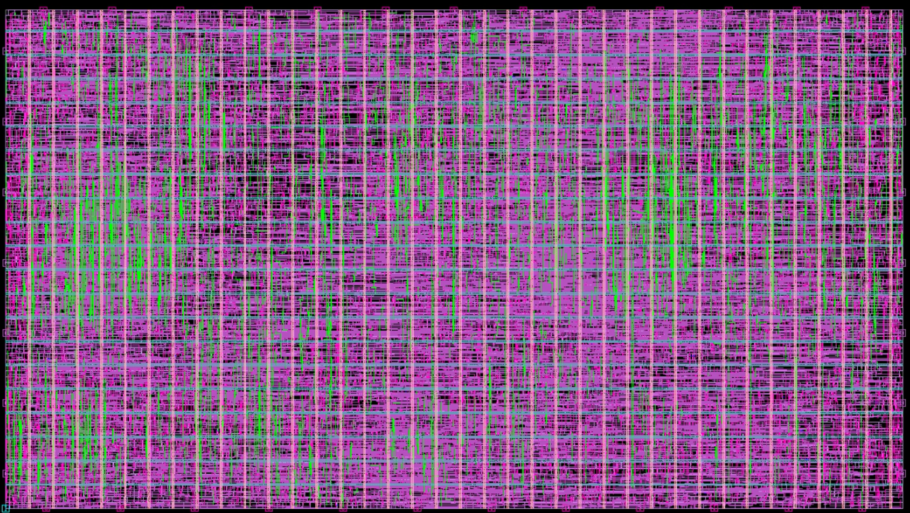

# EL5807 Introducción al Diseño de Circuitos Integrados (VLSI)

## Diseño de Graduación de VLSI: Micro8088 (Síntesis → Place → CTS → Route)

Tarea Final del curso **Introducción al Diseño de Circuitos Integrados (VLSI)**, Instituto Tecnológico de Costa Rica (TEC), II semestre 2025.

- **Autor:** Jeffrey Salas
- **Profesor:** Ing. Kervin Sánchez, M.Sc.
- **Diseño:** `Micro8088` (procesador 8088 descrito en Verilog, proporcionado por el profesor)
- **Tecnología:** SAED 90 nm (`saed90nm_max.db`, `saed90nm_1p9m_1t_nominal.tluplus`)
- **Herramientas:** Synopsys Design Compiler (`dc_shell`) para Síntesis e IC Compiler II para Place, CTS y Route

## Layout obtenido Micro8088


---

## Descripción

El objetivo es tomar un diseño, el procesador `Micro8088`, y llevarlo por el flujo completo de **síntesis, placement, CTS y routing**, generando reportes en cada etapa de optimización (`place_opt`, `clock_opt`, `route_opt`) y analizando cómo evolucionan las métricas del diseño, al final se obtiene el layout del diseño.

El flujo se ejecutó en un servidor remoto. Este repositorio contiene únicamente los **scripts** y **reportes** del flujo, junto con el documento de entrega.

## Estructura del repositorio

```
├── Tarea_Final_Entrega.pdf  # Documento de entrega (scripts, reportes, análisis y layout)
└── Project/
    ├── SYN/
    │   ├── scripts/    # constraints.tcl, syn.tcl, syn_reports.tcl
    │   └── reports/    # Reportes de síntesis
    └── PLACE/
        ├── scripts/    # constraints.tcl, place_and_route.tcl, place_reports.tcl
        └── reports/    # Reportes por etapa: sin optimizar, place_opt, clock_opt, route_opt
```

> **No se incluyen** los archivos Verilog del 8088 ni las bibliotecas (`.db`, `.tluplus`, `.ndb`), ni los archivos generados por las herramientas (`.ddc`, `.ndm`).

## Requisitos del enunciado y cómo se implementaron

| Requisito | Implementación |
|---|---|
| Flujo desde síntesis (`dc_shell`) hasta route | `syn.tcl` → `place_and_route.tcl` |
| Reportes en cada etapa | Sin optimizar, `place_opt`, `clock_opt` y `route_opt` |
| Floorplan nuevo, utilización 98 %, proporción 16:9 | `initialize_floorplan` con `-side_length {450 253}` (≈ 16:9) y `-core_utilization 0.90` inicial; tras las optimizaciones la utilización final es **98.38 %** |
| No usar `set_dont_touch_network` | No se utiliza |
| Power mesh solo con M5 y M6, width 1, pitch 24 | `create_pg_mesh_pattern` con M6 vertical y M5 horizontal, `width:1`, `pitch:24` |
| Reloj de 1 ns con uncertainty de 5 % | `create_clock -period 1` y `set_clock_uncertainty` de 0.05 (setup y hold) |
| Input/output delay de 20 % del periodo | `set_input_delay` / `set_output_delay -max 0.2` (y `-min 0.0`) |
| Transición máxima de 20 % del periodo | `set_max_transition 0.2` |
| Layers de clock en M5 y M4 | `set_clock_routing_rules -default_rule -max_routing_layer M5 -min_routing_layer M4` |
| Routing blockage M5–M9 para señales | `create_routing_blockage -layers {M5 M6 M7 M8 M9} -net_types {signal}` |

## Scripts

### `SYN/scripts/syn.tcl`

1. Elimina diseños previos y define `target_library` y `link_library` (`saed90nm_max.db`).
2. Lee y analiza todos los `.v` de `../source`, y hace `elaborate` y `link` del top `Micro8088`.
3. Guarda el diseño precompilación (`diseno_precompile.ddc`).
4. Carga `constraints.tcl`, corre `check_design` y `compile_ultra`.
5. Guarda `diseno_postcompile.ddc`, la netlist `diseno.v` y las constraints `diseno.sdc`.

### `SYN/scripts/constraints.tcl`

Reloj de 1 ns, uncertainty de 0.05 ns, latencia 0, input/output delays (máx. 0.2 ns, mín. 0.0 ns), `set_max_transition 0.2` y `set_max_fanout 10` en `Micro8088`.

### `PLACE/scripts/place_and_route.tcl`

1. Crea la biblioteca de diseño y de referencia (`diseno.ndm` y `my_ref_lib.ndb`), y lee la netlist sintetizada.
2. Crea el floorplan (450 × 253) y el blockage de señales en M5–M9.
3. Define el dominio de alimentación (`VDD`/`VSS`) y construye el power mesh en M5/M6.
4. Carga constraints, coloca los pines y ejecuta el placement.
5. Configura voltaje (0.70 V en VDD), parámetros parásiticos y reglas de ruteo del clock.
6. Ejecuta `place_opt` → `clock_opt` → `route_global` / `route_auto` → `route_opt`.

## Resultados

### Evolución por etapa

| Métrica | Sin optimizar | `place_opt` | `clock_opt` | `route_opt` |
|---|---:|---:|---:|---:|
| Celdas | 4035 | 4262 | 4350 | 4370 |
| Peor slack setup (ns) | -25.03 | -16.98 | -15.29 | -15.44 |
| Peor slack hold (ns) | -0.28 | -0.35 | -3.18 | -3.19 |
| Utilización | 85.75 % | 96.27 % | 98.03 % | 98.38 % |
| Potencia total | 0.74 mW | 0.96 mW | 4.69 mW | 4.72 mW |
| Nets | 11048 | 11468 | 11583 | 11639 |
| Nets con violaciones | 4561 | 1549 | 1565 | 1541 |
| Violaciones de transición | 4545 | 1455 | 1481 | 1458 |
| Violaciones de capacitancia | 62 | 135 | 122 | 124 |

### Resumen del diseño final (`route_opt`)

| Métrica | Valor |
|---|---|
| Periodo de reloj | 1 ns |
| Celdas | 4370 |
| Peor slack setup | -15.44 ns |
| Peor slack hold | -3.19 ns |
| Utilización | 98.38 % |
| Potencia | 4.72 mW |
| Nets | 11639 |
| Nets con violaciones | 1541 |
| Violaciones de transición | 1458 |
| Violaciones de capacitancia | 124 |

## Discusión

**DRC.** El chequeo final no reporta violaciones (`TOTAL VIOLATIONS = 0`), por lo que no hay cortos. La herramienta advierte que no hay reglas de antena definidas, por lo que se omitió el análisis de antena.

**Reloj.** El periodo se mantiene en 1 ns en todas las etapas. En `clock_opt` y `route_opt` el reloj pasa a ser *propagated* (CTS), mientras que antes se asumía ideal.

**Celdas y área.** El número de celdas, nets y el área de celdas aumentan en cada etapa por la inserción de buffers e inversores durante la optimización. La utilización pasa de 85.75 % a 98.38 %, cumpliendo el objetivo de 98 %.

**Timing setup.** El peor slack mejora con cada etapa (-25.03 ns → -15.44 ns), pero no desaparecen las violaciones. Hay 626 paths con violación en el grupo `CLK` en todas las etapas.

**Timing hold.** El peor slack empeora (-0.28 ns → -3.19 ns), aunque disminuye la cantidad de violaciones. Los paths críticos son de RST hacia el pin de reset asíncrono de registros, con el clock propagado.

**Potencia.** Aumenta en cada etapa y se multiplica por ~5 con CTS: la red de reloj pasa a ser ~77 % de la potencia total. La potencia de fuga sube sobre todo en la primera optimización.

**Número de celdas de reloj.** La ruta crítica del grupo `CLK` tiene 75 niveles de lógica (QOR de `route_opt`).

**Layout.** Se muestra al inicio de este README y también se encuentra en `Tarea_Final_Entrega.pdf`. Los blockages de M5–M9 se hicieron transparentes en la vista de capas para poder observar el ruteo.

## Estado de convergencia

El diseño **no converge** en timing con las constraints actuales. Lo que se observa en los reportes:

- **Setup:** el path crítico tiene ~15.7 ns de longitud frente a un periodo de 1 ns, por lo que se necesitaría relajar el periodo o reestructurar la lógica (por ejemplo, con pipeline).
- **Hold:** las violaciones empeoran después del CTS, con latencias de captura (~3.6 ns) muy superiores a las de lanzamiento (~0.6 ns) en los paths de RST. Se necesita reducir el skew del reloj y/o insertar corrección de hold.
- **Design rules:** quedan 1541 nets con violaciones (1458 de transición y 124 de capacitancia).

## Cómo reproducir

Los scripts usan rutas relativas (`../libs`, `../source`, `../dbs`, `../reports`, `../scripts`, `../work`), así que habría que recrear la estructura de directorios.

```
Project/
├── SYN/    { dbs, libs, logs, reports, scripts, source, work }
└── PLACE/  { dbs, libs, logs, reports, scripts, source, work }
```

1. Colocar en `SYN/source` los `.v` del `Micro8088` y en `SYN/libs` la biblioteca `saed90nm_max.db`.
2. Desde `SYN/work`, ejecutar `dc_shell -f ../scripts/syn.tcl`.
3. Copiar la netlist generada (`diseno.v`) a `PLACE/source` y las bibliotecas (`saed90nm_1p9m_1t_nominal.tluplus`) a `PLACE/libs`.
4. Desde `PLACE/work`, ejecutar `icc2_shell -f ../scripts/place_and_route.tcl`.

## Créditos

Diseño `Micro8088`, bibliotecas y ambiente de trabajo proporcionados por el profesor Kervin Sánchez en el curso Introducción al Diseño de Circuitos Integrados (TEC).